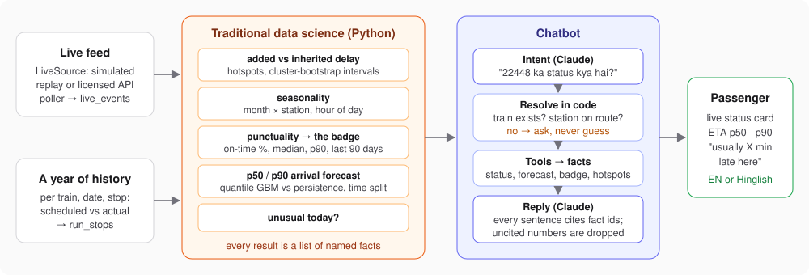
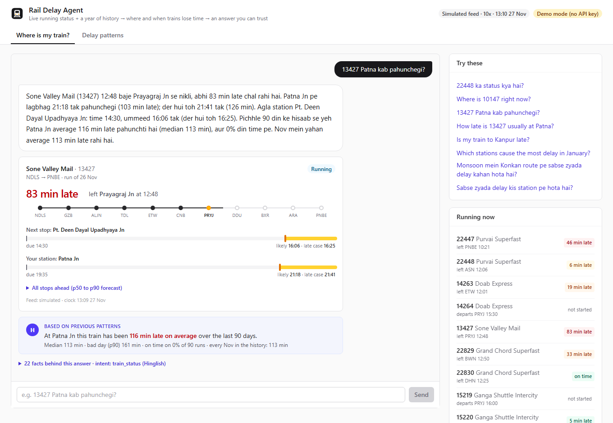

# Rail Delay Agent

"Where is my train, and how late will it be?" Indian trains run late often: winter fog on the Delhi - Kanpur - Prayagraj line, monsoon on the Konkan coast, congestion at big junctions. Most passengers do not know which app to open or where to type the number. This project is a chatbot you can ask in plain English or Hinglish (*"22448 ka status kya hai?"*), and it answers with the **live position and delay**, a **p50 to p90 arrival forecast** for the stops ahead, and a small badge: **"based on previous patterns, this train has been X min late on average here"**.

Under the chat sits traditional data science on a year of running history: which stations **add** delay and which only **inherit** it from earlier stops, in which **months** and at which **hours**, how punctual each train is, and a quantile model that beats the "delay stays the same" baseline. The language model reads the question and phrases the answer; every number comes from Python, and any sentence citing a number that was not computed is deleted.

It is a complete starter project: a FastAPI backend with separate ingestion, analysis, agent and LLM layers, a React + TypeScript frontend, a simulated network with planted patterns and an eval harness that checks the analysis finds them, tests that run without an API key, and a demo mode so you can click through everything before spending a rupee.





> **Simulated data, not affiliated.** Station codes and approximate coordinates are real. Every train, number, name, timetable and minute of delay in this repo is made up, and any match with a real train is a coincidence. This project is not affiliated with or endorsed by Indian Railways, IRCTC, CRIS or NTES. See [Responsible use](#responsible-use).

## Features

- **Live ingestion behind one interface.** A `LiveSource` protocol with a simulated feed (two held-out days replayed on an accelerated clock) and a documented, switched-off stub for a third-party running-status API. A poller stores arrivals and departures in a `live_events` table, deduplicated, inside the API or as its own process.
- **Added vs inherited delay.** For every arrival: delay inherited from the previous stop, and delay added on the approach. Ranking by arrival delay blames the end of the line (in the demo, Ara looks worst at 60 min, but adds 4); ranking by added delay finds the junction that actually loses time (DDU, +22 min), with 95% intervals from a **cluster bootstrap by day**.
- **Seasonality.** A month x station heatmap and automatic seasonal months per station (finds Dec-Jan fog and Jul-Aug monsoon), and an **hour-of-day** profile with seasonal months left out, so night fog is not mistaken for an hour effect (finds DDU's 18:00-21:00 window).
- **Punctuality and the badge.** On-time % (within 15 min), mean, median and p90 delay per train and stop over the last 90 days, plus the same calendar month across the history.
- **Arrival forecast.** Gradient-boosted quantile models (p50 and p90) from the current delay, distance and stops ahead, calendar, and the historical added delay of the stations ahead; scored on a **time-based hold-out** against persistence (40% lower error, p90 coverage 92% on the demo data).
- **"Unusual today."** Today's delay vs that train's own history at that stop: 80 minutes at a station where it is usually 9 late is news; 110 minutes for a train that is always 110 late is not.
- **A chatbot that never guesses.** Claude turns the message into a structured intent (train, station, months, language). Code validates it against the timetable: an unknown number, a name shared by two directions, "Mumbai" (CSMT or Mumbai Central?) or a station off the route becomes a clarifying question with buttons. Replies cite fact ids; uncited sentences and sentences with numbers not in their facts are dropped.
- **Evaluation.** `python -m app.cli --fake eval` scores the hotspots, seasonal months, hour window, punctuality ranking, forecast, unusual flag and chatbot intent parsing against the planted truth.
- **Demo mode.** `LLM_PROVIDER=fake` runs everything offline: keyword rules read the message, templates write the answer from the same facts.

## Quickstart

You need **Python 3.11+** with [uv](https://docs.astral.sh/uv/), and **Node.js 20+**.

### 1. Server

macOS / Linux:

```bash
cd server
cp .env.example .env        # then set ANTHROPIC_API_KEY, or LLM_PROVIDER=fake
uv sync
uv run uvicorn app.main:app --reload
```

Windows (PowerShell):

```powershell
cd server
Copy-Item .env.example .env   # then set ANTHROPIC_API_KEY, or LLM_PROVIDER=fake
uv sync
uv run uvicorn app.main:app --reload
```

The API runs on http://localhost:8000 (docs at http://localhost:8000/docs). On first start it loads a year of simulated history from [`samples/`](samples/), trains the models (about 20 seconds) and starts the simulated live feed at 12:00 on 27 Nov 2026, running ten times faster than real time.

### 2. Client

In a second terminal:

```bash
cd client
cp .env.example .env          # PowerShell: Copy-Item .env.example .env
npm install
npm run dev
```

Open http://localhost:5173. Try **22448 ka status kya hai?**, then **Is my train to Kanpur late?** (it asks which train), then open **Delay patterns**.

### Or from the command line

```bash
cd server
uv run python -m app.cli --fake demo     # seed, ingest, train, print the patterns and sample chats
uv run python -m app.cli --fake eval     # score everything against the planted truth
uv run python -m app.cli --fake ask "13427 Patna kab pahunchegi?"
```

Drop `--fake` to use Claude.

### No API key yet?

Set `LLM_PROVIDER=fake` in `server/.env`. The statistics, the forecast, the live feed, the UI and the eval are identical, because none of them use the model. What changes: keyword rules read the message instead of Claude (they handle the example phrasings, not every way a person can ask), and the answer comes from templates.

## The demo data

[`server/scripts/make_samples.py`](server/scripts/make_samples.py) simulates 17 fictional trains on four real corridors (Delhi - Howrah via Patna, the Grand Chord via Gaya, Delhi - Mumbai, and Mumbai - Konkan - Mangaluru) for 2025-11-01 to 2026-11-27: about 52,000 stop rows of scheduled and actual times. Planted for the analysis to find, and written to [`samples/ground_truth.json`](samples/ground_truth.json):

| Planted in the data | What the analysis should find |
| --- | --- |
| Fog in December and January on Aligarh - Tundla - Etawah - Kanpur - Prayagraj, worst at night, shared across trains each day | Those stations seasonal in Dec, Jan; Kanpur tops January |
| Monsoon in July and August from Panvel to Udupi | Those stations seasonal in Jul, Aug; Ratnagiri tops the monsoon |
| Arrivals at DDU due 18:00-22:00 wait for a platform, all year | DDU is the #1 added-delay station; an 18:00-21:00 window, no other station |
| 13427 Sone Valley Mail late from its origin and slow everywhere | Least punctual train (0% on time) |
| 22973 Tapi Chair Car Express | Most punctual train (100% on time) |
| Delay carried into a stop is carried out of it | Stations after DDU have big arrival delays and small added delays |
| 10147 held 80 min before Ratnagiri on the live day | Flagged "unusual today"; almost nothing else is |

## How it works

1. **Ingest.** History (`samples/history.csv.gz`, or your own export via `cli ingest --history`) goes into `run_stops`. The poller asks the `LiveSource` for new arrivals and departures and stores them in `live_events`.
2. **Analyse** (`app/analysis/`, plain pandas, numpy and scikit-learn, no LLM). Station profile (added vs inherited, cluster bootstrap), seasonality (month heatmap, hour-of-day), reliability (the badge), forecaster (quantile GBMs, time-based evaluation), unusual-today rule. Each returns typed reports with **named facts**.
3. **Chat** (`app/agents/chat.py`). Intent from the model as structured output, then resolution in code (train must exist, station must be unique and on the route, otherwise ask), then tools (live status + forecast, badge, hotspots) that return facts, then a reply whose sentences cite fact ids and are checked.
4. **Show.** The status card, ETA band, badge and every chart in the client are drawn from the structured results, not from the model's text.

The statistics are explained for non-statisticians in [docs/methods.md](docs/methods.md); the code layout in [docs/architecture.md](docs/architecture.md); endpoints in [docs/api.md](docs/api.md); where real data could come from (and where it must not) in [docs/data-sources.md](docs/data-sources.md).

## Configuration

Server settings live in `server/.env`, documented line by line in [`server/.env.example`](server/.env.example).

| Variable | Default | What it does |
| --- | --- | --- |
| `LLM_PROVIDER` | `anthropic` | `anthropic` for Claude, `fake` for offline demo mode |
| `ANTHROPIC_API_KEY` | (empty) | Your key; falls back to the environment variable of the same name |
| `ANTHROPIC_MODEL` | `claude-opus-5-5` | Model for the intent and the reply |
| `ANTHROPIC_EFFORT` / `INTENT_EFFORT` | `medium` / `low` | Effort for the reply / for reading the message |
| `LIVE_SOURCE` | `simulated` | `simulated` replay, or `http` for the unverified third-party stub |
| `LIVE_POLL_SECONDS` | `5` | Poll interval inside the API; `0` = off |
| `LIVE_START` / `LIVE_SPEED` | `2026-11-27T12:00` / `10` | The simulated clock's start and speed |
| `RUNNING_STATUS_API_URL` / `_KEY` | (empty) | Only for `LIVE_SOURCE=http` |
| `SEED_DEMO` | `true` | Load the sample history into an empty database |
| `DATA_DIR` / `DATABASE_URL` | `data` / SQLite | Where the database lives; any SQLAlchemy URL works |
| `CORS_ORIGINS` | `http://localhost:5173,...` | Origins allowed to call the API |

Editorial choices are data, not code: stations, aliases, ambiguous names, corridors and timetables in [`network.json`](server/app/config/network.json); thresholds (on-time margin, badge window, seasonal and hour rules, unusual rule, model settings) in [`analysis.json`](server/app/config/analysis.json); example questions in [`chat.json`](server/app/config/chat.json). Client: `client/.env` has `VITE_API_URL` (default `http://localhost:8000`).

## Project structure

```
rail-delay-agent/
├── server/
│   ├── app/
│   │   ├── main.py              # FastAPI app factory; lifespan seeds, trains, starts the poller
│   │   ├── container.py         # composition root: settings, DB, LLM, live source, services
│   │   ├── cli.py               # demo / eval / ask / train / ingest
│   │   ├── core/                # settings, catalog (network.json & co), errors, logging
│   │   ├── ingest/live.py       # LiveSource protocol, simulated replay, third-party API stub
│   │   ├── analysis/            # the statistics: plain functions, no LLM
│   │   │   ├── dataset.py       # raw rows -> delays, inherited, added
│   │   │   ├── stations.py      # hotspots, cluster bootstrap intervals
│   │   │   ├── seasonality.py   # month heatmap, seasonal months, hour-of-day windows
│   │   │   ├── reliability.py   # on-time %, median, p90: the badge
│   │   │   ├── predict.py       # quantile GBMs, persistence baseline, time-based split
│   │   │   └── unusual.py       # "unusual today"
│   │   ├── agents/
│   │   │   ├── chat.py          # intent -> resolve -> tools -> cited reply
│   │   │   ├── tools.py         # tool results as named facts
│   │   │   ├── citations.py     # drop claims citing unknown facts or numbers
│   │   │   └── templates.py     # deterministic writer (demo mode and fallback)
│   │   ├── services/            # history import, analytics build, live poller, demo seed, eval
│   │   ├── api/routes/          # health, network, chat, trains, live, patterns
│   │   ├── llm/                 # LLMClient protocol, Claude client, FakeLLM, prompts/*.md
│   │   └── config/              # network.json, analysis.json, chat.json
│   ├── scripts/make_samples.py  # regenerates samples/ (seeded)
│   └── tests/                   # pytest; FakeLLM and a frozen clock, no key needed
├── client/src/
│   ├── api/                     # fetch wrapper, endpoints, types
│   ├── hooks/queries.ts         # React Query hooks (polling lives here)
│   ├── features/chat/           # chat thread, status card + ETA band, history badge
│   ├── features/patterns/       # SVG route map, hotspots, heatmap, hour chart, model card
│   └── features/live/           # the "running now" board
├── samples/                     # history, live replay, ground truth, labelled chat messages
└── docs/                        # methods, architecture, data sources, API, extending, resume notes
```

## Build on top of this

1. **A real feed.** Implement `LiveSource` for a provider you have a licence for (see [docs/data-sources.md](docs/data-sources.md)); nothing else changes.
2. **Network-wide nowcast.** If every train on the fog stretch is gaining delay this morning, the next one will too. Add "delay added by other trains on this section in the last 2 hours" as a feature.
3. **Close the loop.** Move finished live runs into `run_stops` every night and rebuild, so the badge and the model keep learning.
4. **Push alerts.** Notify a passenger when the p50 at their station moves by more than 15 minutes, or when today turns unusual.
5. **WhatsApp or Telegram front end.** The chat endpoint already takes a message and a context; a bot is a thin adapter.
6. **Delay causes.** Join weather data (visibility, rainfall) to replace the month proxy with the real driver.
7. **Survival models.** Model "probability of reaching by 14:00" directly, instead of two quantiles.

[docs/extending.md](docs/extending.md) walks through adding a station, a train, a tool or a data source. Putting it on a resume? [docs/resume.md](docs/resume.md) has bullet points and the interview questions this project prepares you for.

## Development

```bash
# server
cd server
uv run pytest            # no API key needed
uv run ruff check .
uv run ruff format .

# client
cd client
npm run lint
npm run build
```

CI runs the same commands on every push ([`.github/workflows/ci.yml`](.github/workflows/ci.yml)).

## Troubleshooting

- **"Anthropic rejected the API key"**: set `ANTHROPIC_API_KEY` in `server/.env` (not `client/.env`) and restart the server, or set `LLM_PROVIDER=fake`.
- **`503 not_ready`** from the patterns endpoints: the models are still training on first start; the header shows "Training on the history". Wait about 20 seconds.
- **"Cannot reach the API"** in the browser: the server is not running, or `VITE_API_URL` in `client/.env` points elsewhere. Restart `npm run dev` after editing `.env`.
- **Port 8000 already in use**: `uv run uvicorn app.main:app --reload --port 8010` and set `VITE_API_URL=http://localhost:8010`.
- **CORS error**: add your client's origin to `CORS_ORIGINS` in `server/.env`.
- **The live board stopped moving**: the simulated replay covers 26 and 27 Nov 2026 only. Restart the server to start the clock again, or set `LIVE_START`.
- **Every train says "not started"**: the clock is before the first departures, or `LIVE_POLL_SECONDS=0` and nothing is polling. `POST /api/live/poll` polls once.

## Responsible use

- **Not an official source.** Never present this as Indian Railways, IRCTC or NTES information, and do not use their names or logos in a deployment. For real journeys, passengers should rely on official channels.
- **No scraping.** Indian Railways publishes no official public API for live running status. Do not scrape NTES, IRCTC or similar sites; it breaks their terms and can get your IP blocked. Use a provider you have a licence or written permission for, and follow its rate limits. Details in [docs/data-sources.md](docs/data-sources.md).
- **Forecasts are estimates.** The p50 is the middle of a range, and the p90 is wrong one time in ten by design. The UI always shows the band, not a single promised time.
- **No personal data.** The app stores trains, stations and times, never who is travelling. If you add accounts or alerts, follow the Digital Personal Data Protection Act, 2023.

## License

[MIT](LICENSE)
